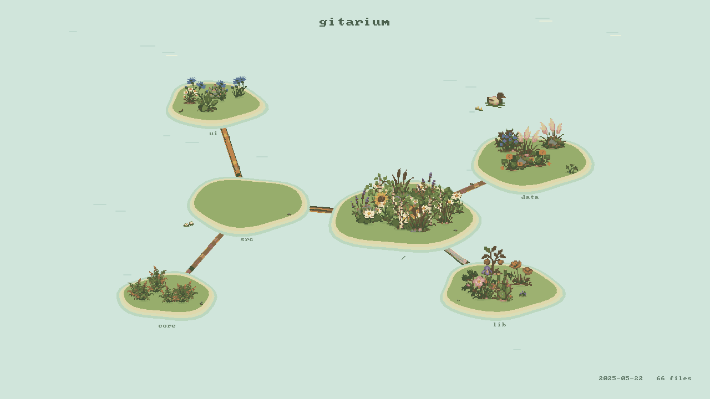

# Gitarium

A Rust CLI that grows a pixel-art island garden from a Git repository. Directories become low grassy islands in a pale pond. Files become plants, flowers, stones, and mushrooms. Export a still image or an H.264 MP4 of the repository growing through its commit history.



## Install and run

Install [Rust](https://rust-lang.org/tools/install/) 1.85 or newer, Git, and FFmpeg with the `libx264` encoder.

```sh
git clone https://github.com/sheinid/gitarium.git
cd gitarium
cargo install --path . --locked

gitarium doctor
gitarium demo -o garden.mp4
gitarium snapshot /path/to/repository -o garden.png
gitarium export /path/to/repository -o growth.mp4 --duration 30
```

`demo` also accepts a `.png` output. To run directly from the checkout, use `./gitarium` instead of the installed command. The launcher uses a release build when available and compiles one with Cargo otherwise.

PNG rendering needs no FFmpeg. The sprite atlas is embedded in the executable. Video export checks an explicit `--ffmpeg` path, then `GITARIUM_FFMPEG`, then an encoder next to the binary, the development `.tools/ffmpeg`, and finally `ffmpeg` on PATH.

## Commands

| Command | Result |
| --- | --- |
| `export REPOSITORY -o growth.mp4` | Animate the selected committed history |
| `snapshot REPOSITORY -o garden.png` | Render the latest selected state |
| `inspect REPOSITORY` | Show history statistics and species counts |
| `demo -o garden.mp4` | Render the bundled 48-observation example |
| `species` | List all 32 file species, 16 shoreline assets, and 16 bridge variants |
| `doctor` | Check Git and H.264 encoder availability |
| `schema export` | Inspect typed arguments derived from the CLI definitions |

Run any command with `--help` for its flags. Standard output defaults to JSON when piped, and readable text in a terminal. Override with `--format json` or `--format human`. Render progress goes to standard error as JSON events. Success and failure envelopes carry `meta.schema_version`. Exit codes are 0 for success, 1 for runtime errors, and 2 for invalid CLI arguments. Commands never prompt.

## Shape the garden

```sh
# Follow a branch, limit the period, and pace by elapsed calendar time.
gitarium export . --revision main --since 2025-01-01 --until 2025-12-31 \
  --calendar --duration 45 --hold 3 -o year.mp4

# Larger video, deeper child islands, and more islands.
gitarium export . --width 1920 --height 1080 --depth 3 \
  --max-islands 32 --island-threshold 24 --max-plants 1000 --fps 30 -o garden.mp4

# Exclude generated files with repository-relative globs.
gitarium snapshot . --exclude '**/*.min.js' --exclude 'assets/**' -o garden.png

# Inspect a state halfway through the sampled history.
gitarium snapshot . --progress 0.5 -o halfway.png

# Describe a render without creating any files or starting the encoder.
gitarium export . -o garden.mp4 --dry-run
```

Use `--force` to replace an existing output. Output is rendered into a temporary file in the destination directory and published only after success. The source repository is never checked out or modified. A 16:9 aspect ratio fits the composition best. Width and height must be even for MP4.

`--duration` includes the final `--hold`, which defaults to 2 seconds. For shorter videos, reduce `--hold`. Default output is 1280 by 720 at 24 fps for 20 seconds.

## Plants and shoreline assets

There are 32 file species, 16 shoreline assets, and 16 bridge variants. `gitarium species` prints the full catalog and file associations.

| Files | Plants |
| --- | --- |
| Rust / TypeScript / JavaScript / Python | Fern / cornflower / sunflower / lavender |
| Go / C and C++ / Java and Kotlin / Swift | Bamboo / prickly pear / tulips / apple sapling |
| Ruby / PHP / Haskell / Lua / Elixir | Poppies / iris / heather / violets / wild rose |
| CSS / Sass and Less | Succulent / chamomile |
| Tests / documentation | Daisies / birch saplings |
| TOML / JSON / YAML / other config | Sedum / maidenhair fern / rushes / river stones |
| Lockfiles / build recipes / shell | Mushrooms / oat grass / cattails |
| SQL / GraphQL / tabular data / R and Julia | Mossy stone / blueberries / pampas grass / nasturtium |
| Templates / media / other files | Broadleaf herbs / water lilies / clover |

Lockfiles take priority over config detection. Test detection takes priority over language detection. Plant size depends on blob size and age in observed snapshots. New files sprout and deleted files shrink away. Path hashes keep positions, orientation, and shoreline details stable during playback.

The renderer uses a shared 22-color sprite palette and small native pixel grids. The pond has sand banks, a few reeds, stones, logs, lily pads, and ducks. The repository name sits at the top. Directory labels and a small footer with the date and file count provide the remaining context. There are no dashboard panels, legends, badges, glow effects, floating undersides, or hanging roots.

## History and scale

Gitarium reads first-parent history from the selected revision. Merge commits use the complete merged tree, including files introduced on the merged branch. It reads blob IDs, paths, and sizes, without opening source file contents. Dirty working-tree files and untracked files do not appear. Bare repositories work too.

The default maximum is 240 evenly sampled snapshots, including both endpoints. Increase `--max-commits`, up to 2000, to observe more commits. A limit of one shows the final state. Date ranges are inclusive UTC commit dates. Calendar mode uses a monotone timestamp envelope to handle clocks that move backwards. Normal playback allocates equal time to each sampled observation.

Sampling can skip short-lived files and intermediate edits. Renames appear as removal and planting at the new path. Species rules currently live in `src/species.rs`. Submodule contents belong to another repository and are skipped. Git paths must be valid UTF-8; labels replace unsupported glyphs with `?`. Shallow repositories show only available history and carry a visible warning.

Tracked `node_modules`, `target`, `vendor`, `dist`, `build`, `.next`, `__pycache__`, and `.venv` directories are hidden by default. Use `--include-generated` to include them.

## Nested islands and bridges

The root island is always present. A directory earns a child island when its filtered subtree contains **more than N files** at an observed commit. This includes its descendants. When it crosses that boundary, its files move from the nearest active ancestor to the new island. If the count falls back to N or less, they return to the ancestor. Files belong to exactly one island at a time.

By default N adapts to the selected repository. Take the latest snapshot's average files per nonempty directory, multiply by six, and round up to a multiple of four, bounded to 12..64. For small repositories, lower this to at most one twelfth of the total file count, with a minimum of four. This is a display heuristic based on the current repository, not a claim about a global average. An empty latest state uses the observed path union to estimate N.

For example, 720 files across 180 nonempty directories average four files per directory. The resulting threshold is **N = 24**. Use `--island-threshold 24` to set N explicitly. `--dry-run` returns the chosen threshold, directory average, island depths, parents, radii, and owned-file counts in the `layout` result.

Island radius is proportional to `0.8 ^ directory_depth`. Deeper islands are always smaller than their ancestors. Parent links follow the real directory tree. Every child has one bridge to its nearest displayed parent. Bridge routes avoid unrelated islands and their banks. The 16 bridge sprites include plain planks, rails, rope, bamboo, logs, repaired boards, and flat stone slabs. Bridges appear and disappear with their child island.

The layout plans eligible islands from the maximum simultaneous subtree count across the selected observations. Renamed or deleted historical paths do not inflate this count. Planning the tree once keeps the camera and island positions fixed throughout the timelapse. The default maximum depth is six, with at most 32 islands. If more directories qualify, larger subtrees take priority, and the selected tree retains its ancestors. Other files stay on their nearest displayed ancestor.

The plant budget is shared across active islands. Each island's capacity depends on its area, so deeper islands have fewer visible plants. CLI counts still include every filtered file. Images remain free of density counters.

## Development

```sh
cargo test --locked
cargo fmt --check
cargo clippy --all-targets -- -D warnings
GITARIUM_TEST_FFMPEG=/path/to/ffmpeg cargo test --release --locked
cargo build --release --locked
```

The tests create isolated repositories and cover merges, edits, deletions, renames, unusual file names, filtering, stable rendering, strict island thresholds, directory ancestry, depth-based size, ownership on promotion and retirement, historical path churn, plant budgets, dry runs, schema, and input validation. Setting `GITARIUM_TEST_FFMPEG` enables the MP4 encode/decode roundtrip test.

The renderer uses native Rust image buffers and embedded bitmap text. It streams RGBA frames directly to FFmpeg and does not write a directory of frame images.

## Sprite assets

The plant and shoreline sheets are `assets/pond-plants-a.png`, `assets/pond-plants-b.png`, and `assets/pond-shore.png`. They contain 32 plant sprites and 16 shoreline assets created with the built-in ImageGen tool. `assets/bridges.png` adds 16 bridge sprites. Bridge generation and transparency correction prompts are saved in `assets/bridge-prompts.txt`. The exact prompts are saved in `assets/pond-prompts.txt`. The renderer trims the sheets into sprites, uses hard alpha, fits them to small pixel grids, and maps their colors to a shared palette. This avoids smooth shading and keeps the sprite sheets consistent at game size. `assets/preview.png` is a scene rendered by Gitarium itself. No image-generation API key is needed to run the program.

The Rust source is MIT licensed. FFmpeg is an external dependency and is not distributed in this repository. Its license depends on the build you install. Cargo dependency licenses remain with their respective authors.
